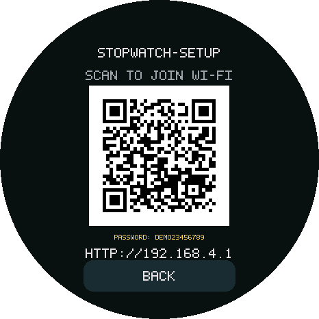
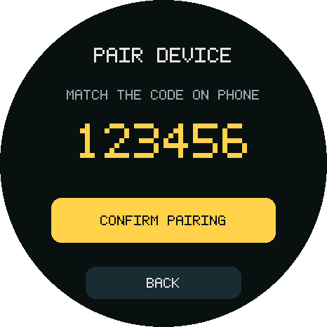
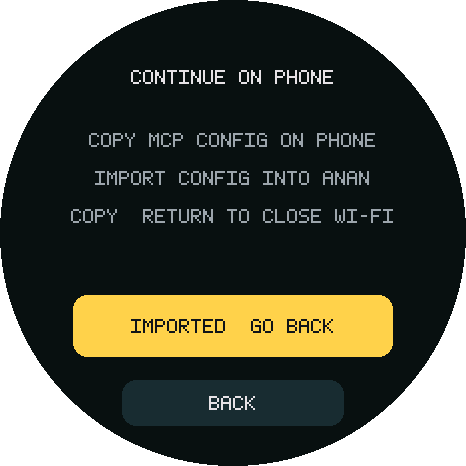
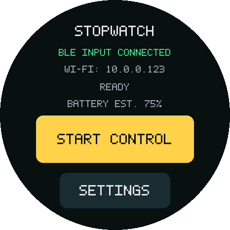
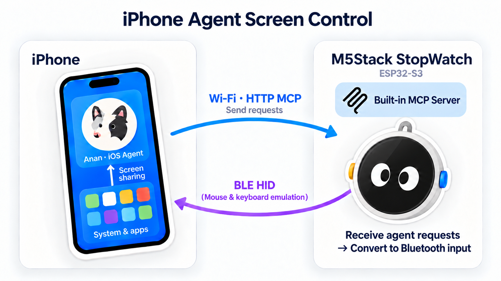

# Anan iPhone Use

English · [简体中文](README.zh-CN.md)

**An iPhone MCP server built for M5Stack StopWatch (ESP32-S3), with USB and Bluetooth mouse and keyboard input.**

The client observes the screen, decides what to do and checks the result; StopWatch executes taps, drags, scrolling and keyboard input. The firmware runs no model and provides no phone screenshots.

Integrated with **[Anan](https://anan.sh) (an entirely client-side agent, coming soon as open source)**. Other MCP agents and ESP32 boards are welcome; the [anan-iphone-use skill](.agents/skills/anan-iphone-use/SKILL.md) guides setup and hardware-specific adaptation.

## Demos and setup

<table width="100%">
<tr>
<th width="33%">Draw in Notes</th>
<th width="33%">Check Xiaohongshu followers</th>
<th width="33%">Do Not Disturb and timer</th>
</tr>
<tr>
<td width="33%" valign="top"><strong>Prompt:</strong> Open Notes and draw a little dog.</td>
<td width="33%" valign="top"><strong>Prompt:</strong> Open Xiaohongshu and check how many followers I have.</td>
<td width="33%" valign="top"><strong>Prompt:</strong> Turn on Do Not Disturb, then start a 25-minute timer.</td>
</tr>
<tr>
<td width="33%" align="center"><video src="https://github.com/user-attachments/assets/33d7dd87-b4b1-479e-a7a7-0841db6cd780" width="260" controls></video></td>
<td width="33%" align="center"><video src="https://github.com/user-attachments/assets/1da03439-f745-4556-b9c4-40b6d5ac10b6" width="260" controls></video></td>
<td width="33%" align="center"><video src="https://github.com/user-attachments/assets/f7dc814c-bf89-4d8d-bdd8-1e7c6a837279" width="260" controls></video></td>
</tr>
</table>

After flashing, choose a connection:

- **Wireless:** scan the StopWatch Wi-Fi QR, open `http://192.168.4.1`, confirm MCP pairing, then select your 2.4 GHz Wi-Fi. Copy the MCP configuration before closing setup; rejoin your usual Wi-Fi, import it, then select BLE input and pair **Anan StopWatch** on iPhone.
- **USB:** connect StopWatch to iPhone, configure USB Ethernet (`192.168.7.2`, mask `255.255.255.0`, no router/DNS), then open `http://192.168.7.1` to pair and import MCP.

Enable AssistiveTouch for either route, then tap **Start control** on StopWatch: white eyes on black react to input, tilt and touch, with colored cursors and keycaps during operations. Press either front key to stop and return Home. Wireless setup is illustrated below; [full setup and recovery](docs/wireless.md) covers both routes.

> **Avatar credit:** the expressive eyes are adapted from **[Trentct/m5stack-stopwatch-avatar](https://github.com/Trentct/m5stack-stopwatch-avatar)**, with MCP input feedback added here.

<table>
<tr>
<th>1 · Join the setup hotspot</th>
<th>2 · Confirm MCP pairing</th>
<th>3 · Copy config before leaving</th>
<th>4 · Pair BLE and start control</th>
</tr>
<tr>
<td></td>
<td></td>
<td></td>
<td></td>
</tr>
</table>

*Static illustrations [rendered from the firmware layout](tools/render_ui.py), not device screenshots. Codes, Wi-Fi password, IP and battery values are synthetic examples; MCP pairing is separate from Bluetooth pairing.*

## How it works

A phone or computer agent reaches StopWatch's MCP over USB networking or Wi-Fi; StopWatch sends input to iPhone over USB or experimental BLE. Network access and input selection are independent, so Wi-Fi MCP can also control a USB-connected phone.



## What you need

| Item | Requirement |
| --- | --- |
| Device | M5Stack StopWatch (ESP32-S3); computer and data cable for initial flashing |
| Phone | iPhone with AssistiveTouch enabled; USB input requires a USB-C connection |
| Client | [Anan](https://anan.sh), or a phone/computer HTTP MCP client with access to the USB subnet or Wi-Fi LAN |
| Screen observation | Supplied by the client; [Anan](https://anan.sh)'s system screen sharing requires iOS 27+ |

## Quick start

```sh
git clone https://github.com/ananhq/anan-iphone-use.git
cd anan-iphone-use
```

Open your agent in the repository directory and enter:

```text
Use $anan-iphone-use to identify my board, flash the firmware and set up iPhone MCP.
If the skill is not discovered, first read .agents/skills/anan-iphone-use/SKILL.md.
```

The skill guides flashing and connection setup, or minimal adaptation for another ESP32 board. Update through `flash.sh` / `flash.py` to preserve BLE pairing and Wi-Fi/MCP settings; see [flashing instructions](docs/setup.md).

## MCP interface

Default endpoint: **`http://stopwatch.local/mcp`** over USB/Wi-Fi; USB fallback: `http://192.168.7.1/mcp`. Import the exported configuration, including its Bearer header; switching USB/BLE input does not require a new import.

| Method | Purpose | Parameters |
| --- | --- | --- |
| `device_status` | Read connection, control grant and input-busy status | None |
| `tap` | Single click, double-click or long press | <ul><li><code>x, y</code>: position</li><li><code>count</code>: 1 click or 2 clicks</li><li><code>holdMs</code>: long-press duration</li><li><code>intervalMs</code>: double-click interval</li></ul> |
| `drag` | Swipe, drag or draw a continuous stroke | <ul><li><code>points</code>: ordered coordinates; 2 for a straight line, more for a path</li><li><code>durationMs</code>: movement duration</li><li><code>holdMs</code>: hold before moving</li></ul> |
| `press_key` | Keyboard, editing and system/media keys | <ul><li><code>key</code>: name, e.g. <code>tab</code>, <code>copy</code>, <code>home</code>, <code>search</code></li><li><code>repeat</code>: navigation repeat count</li><li><code>pressMs, gapMs</code>: press duration and repeat interval</li></ul> |
| `type_ascii` | Type ASCII text into focused input | <ul><li><code>text</code>: text to enter; no Chinese/Unicode</li></ul> |
| `scroll` | Scroll a chosen region | <ul><li><code>x, y</code>: target position</li><li><code>vertical, horizontal</code>: signed wheel amounts, not pixels</li><li><code>repeat, gapMs</code>: repeat count and interval</li></ul> |
| `stop` | Interrupt input and revoke control | None |

Coordinates are portrait-normalized **0…1**; times are in milliseconds. Screen observation comes from the client. See [tool reference](docs/hid-tools.md) for full parameters/key names and [client integration](docs/client.md) for connection details. Refresh tool discovery after updating firmware.

## Current limitations

- Wi-Fi uses 2.4 GHz and an accessible local network; the setup hotspot pauses BLE and is not an Internet router. Up to five Wi-Fi networks are remembered.
- Portrait, one pointer and US-layout ASCII input only; no direct Chinese text input.
- BLE input remains experimental. Pointer accuracy, reconnection, client interoperability and endurance need device acceptance; build/offline results are recorded separately in [validation](docs/validation.md).

## Comparison and credits

Special thanks to **Trentct and the contributors to [m5stack-stopwatch-avatar](https://github.com/Trentct/m5stack-stopwatch-avatar)**. The control face adapts their expression engine, including expression tables, blinking and transitions. This repository ports it to native ESP-IDF and adds MCP activity animations and rendering/motion adjustments. The [source origin record](main/vendor/stopwatch_avatar/ORIGIN.md) lists the pinned commit and modifications; upstream AGPL-3.0-or-later notices are retained.

Thanks also to **[actell](https://github.com/ja1chen/actell)** for the USB NCM/HID source reference, and **[esp32-iphone-agent](https://github.com/onehumanbeing/esp32-iphone-agent)** for exploring iPhone hardware automation.

| Project | Observation and agent | Action interface | iPhone input |
| --- | --- | --- | --- |
| Anan iPhone Use + [Anan](https://anan.sh) | Phone-side screen sharing and agent | USB/Wi-Fi MCP | USB / experimental BLE absolute positioning and keyboard |
| [actell](https://github.com/ja1chen/actell/tree/e701786d1686823f9ab60524e689e387b7c3b904) | Phone-side agent, CoreDevice display stream | CoreDevice | CoreDevice taps and drags |
| [esp32-iphone-agent](https://github.com/onehumanbeing/esp32-iphone-agent/tree/68584cfc8b3f227d6324ec7c8008c48b53f20a18) | Computer-side AirPlay and Python agent | Wi-Fi TCP | USB relative mouse and keyboard |

actell also retains the USB NCM/HID route referenced here; the table describes its CoreDevice route. esp32-iphone-agent's MIT license and Copyright (c) 2026 Henry Yuan are preserved in the [complete notice](licenses/esp32-iphone-agent-MIT.txt). Exact versions, file origins and modifications are recorded in [THIRD_PARTY](THIRD_PARTY.md).

## License

Existing code retains **[GPL-3.0-only](LICENSE)**. The control avatar incorporates the **[AGPL-3.0-or-later](licenses/StopWatch-avatar-AGPL-3.0.txt)** engine from [Trentct/m5stack-stopwatch-avatar](https://github.com/Trentct/m5stack-stopwatch-avatar); the combination follows GPLv3/AGPLv3 section 13. The setup page offers this build’s [source and build instructions](SOURCE.md).

Upstream copyright notices and applicable licenses for third-party code and fonts are retained in [NOTICE](NOTICE) and [THIRD_PARTY](THIRD_PARTY.md).
