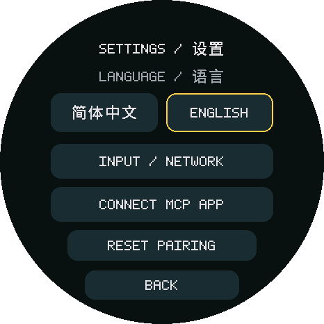
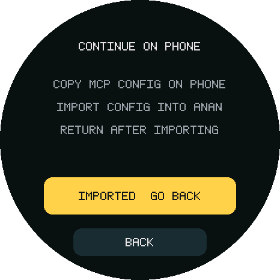
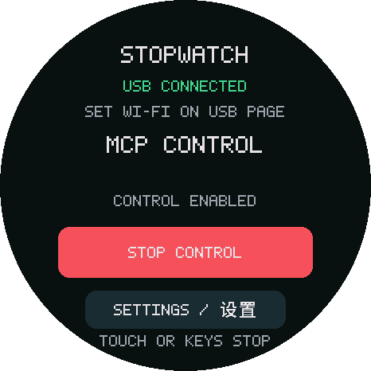
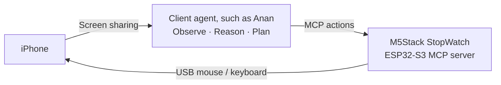

# Anan iPhone Use

English · [简体中文](README.zh-CN.md)

**An MCP server running on ESP32-S3 that operates a real iPhone through USB mouse and keyboard input.**

Connect it to a client agent to add **iPhone Use**: the client observes the screen, decides what to do, calls MCP tools, and checks the result. The firmware executes taps, drags, key presses and ASCII input. It runs no model and provides no phone screenshots.

**This repository is built for M5Stack StopWatch and integrates with [Anan](https://anan.sh) (an entirely client-side agent, coming soon as open source).** It also includes the [anan-iphone-use skill](.agents/skills/anan-iphone-use/SKILL.md): tell your agent to use `$anan-iphone-use` and describe your agent and ESP32 board to get guided client integration and board adaptation.

## Demos and setup

<table width="100%">
<tr>
<th width="33%">Draw in Notes</th>
<th width="33%">Check Xiaohongshu followers</th>
<th width="33%">Do Not Disturb and timer</th>
</tr>
<tr>
<td width="33%" valign="top"><strong>Prompt:</strong> Open Notes and draw a little dog.</td>
<td width="33%" valign="top"><strong>Prompt:</strong> Open Xiaohongshu and check how many followers I have.</td>
<td width="33%" valign="top"><strong>Prompt:</strong> Turn on Do Not Disturb, then start a 25-minute timer.</td>
</tr>
<tr>
<td width="33%" align="center"><video src="https://github.com/user-attachments/assets/33d7dd87-b4b1-479e-a7a7-0841db6cd780" width="260" controls></video></td>
<td width="33%" align="center"><video src="https://github.com/user-attachments/assets/1da03439-f745-4556-b9c4-40b6d5ac10b6" width="260" controls></video></td>
<td width="33%" align="center"><video src="https://github.com/user-attachments/assets/f7dc814c-bf89-4d8d-bdd8-1e7c6a837279" width="260" controls></video></td>
</tr>
</table>

**1 · Connect and configure the local network:** connect the iPhone to StopWatch and set up USB Ethernet on the phone: manual IP `192.168.7.2`, mask `255.255.255.0`, no router or DNS, and enable AssistiveTouch. Then pair, import the MCP configuration and enable control as shown below.

<table>
<tr>
<th>2 · Open connection settings</th>
<th>3 · Match and confirm pairing</th>
<th>4 · Copy JSON on phone and import</th>
<th>5 · Go back and enable control</th>
</tr>
<tr>
<td></td>
<td></td>
<td></td>
<td></td>
</tr>
</table>

*UI illustrations [rendered from the current firmware layout](tools/render_ui.py), not device screenshots; `123456` is a sample pairing code. Open `http://192.168.7.1` in phone Safari to pair and export configuration, with no certificate required. The skill below guides the full setup.*

## How it works



After each action, the client should observe again to verify its effect. Tool completion means input was sent, not that the intended operation succeeded.

## What you need

| Item | Requirement |
| --- | --- |
| Device | M5Stack StopWatch (ESP32-S3) and a USB-C data cable |
| Phone | USB-C iPhone with AssistiveTouch enabled |
| Client | [Anan](https://anan.sh), or an HTTP MCP client that can reach the device's USB subnet |
| Screen observation | Supplied by the client; [Anan](https://anan.sh)'s system screen sharing requires iOS 27+ |

## Quick start

```sh
git clone https://github.com/ananhq/anan-iphone-use.git
cd anan-iphone-use
```

Open your agent in the repository directory and enter:

```text
Use $anan-iphone-use to identify my board, flash the firmware and set up iPhone MCP.
If the skill is not discovered, first read .agents/skills/anan-iphone-use/SKILL.md.
```

The [anan-iphone-use skill](.agents/skills/anan-iphone-use/SKILL.md) reuses StopWatch firmware or minimally adapts another ESP32 for its actual hardware, including controls for boards without screens.

## MCP interface

Default endpoint: `http://192.168.7.1/mcp`. The exported pairing configuration includes the required Bearer header. An optional HTTPS endpoint is also retained.

| Tool | Function | Required arguments | Optional arguments (defaults) |
| --- | --- | --- | --- |
| `device_status` | Read USB, control grant and input-busy status | None | None |
| `tap` | Single click, double-click or long press | `x`, `y` | `count`: 1 or 2 (1); `holdMs`: 0 or 100…2000 (0); `intervalMs`: 50…300 (100), double-click only |
| `drag` | Two-point swipe/drag or multi-point continuous stroke | `points`: 2…32 `{x,y}` objects; `durationMs`: 100…2000 | `holdMs`: 0…1000 (0), wait before moving |
| `press_key` | Named keyboard, editing and system/media keys | `key`: name below | `repeat`: 1…5 (1); `pressMs`: 20…100 (40); `gapMs`: 50…300 (100) |
| `type_ascii` | Type into focused input; no Chinese/Unicode | `text`: 1…120 US-layout ASCII bytes, including TAB/LF | None |
| `scroll` | Send wheel input over a chosen region | `x`, `y`; `vertical`: −10…10 | `horizontal`: −10…10 (0); `repeat`: 1…5 (1); `gapMs`: 50…300 (100) |
| `stop` | Interrupt input and revoke control; physically enable again for further input | None | None |

Coordinates are portrait-normalized **0…1**, with the origin at top-left; times are integer milliseconds. `tap` defaults to a single click: use `count=2` for double-click or `holdMs>0` for long press, never both. `drag` keeps the primary button held through all points and releases at the end; `durationMs` must be at least `20 × (point count − 1)`. Scroll values are signed integer wheel units, not pixels; at least one axis must be nonzero. Start small and observe direction/distance.

<details>
<summary><code>press_key</code> key names</summary>

Navigation (the only keys allowing `repeat>1`): `tab`, `shift_tab`, `up`, `down`, `left`, `right`, `select_left`, `select_right`, `word_left`, `word_right`.

Keyboard/editing: `enter`, `escape`, `space`, `backspace`, `delete`, `command_space`, `select_all`, `copy`, `paste`, `cut`, `undo`, `redo`.

System/media: `home`, `search`, `toggle_keyboard`, `globe`, `volume_up`, `volume_down`, `mute`, `play_pause`, `next_track`, `previous_track`, `brightness_up`, `brightness_down`. `home` opens Home, `search` opens Spotlight, and `toggle_keyboard` toggles the onscreen keyboard. Other effects depend on context; observe toggles before repeating.

</details>

Example tool arguments (not complete MCP requests):

| Operation | Tool | Arguments |
| --- | --- | --- |
| Double-click | `tap` | `{"x":0.5,"y":0.6,"count":2}` |
| Long press | `tap` | `{"x":0.5,"y":0.6,"holdMs":700}` |
| Draw one continuous stroke | `drag` | `{"points":[{"x":0.2,"y":0.3},{"x":0.5,"y":0.6},{"x":0.8,"y":0.3}],"durationMs":800}` |
| Open Home | `press_key` | `{"key":"home"}` |
| Scroll a region | `scroll` | `{"x":0.5,"y":0.6,"vertical":-2}` |

Candidate `0.5.1-mcp` advertises seven tools with concise descriptions, enums and limits; firmware retains compatibility calls. No custom phone bindings or Full Keyboard Access required. Refresh tool discovery after updating firmware. New HID behavior remains device-unverified; see [tool reference](docs/hid-tools.md).

Screen observation belongs to the client and is not a device MCP tool. A desktop or cloud agent needs an explicit network path to the phone's USB subnet; MCP support alone does not make the device reachable. See [client integration](docs/client.md) for parameters and session behavior.

## Current limitations

- M5Stack StopWatch over wired USB is the current target. Wi-Fi/BLE is not implemented.
- Portrait, one pointer and US-layout ASCII input only; no direct Chinese text input.
- Other client interoperability, device regression of the latest MCP-only firmware and endurance remain to be verified. See [validation](docs/validation.md).

## Comparison and credits

Thanks to **actell** for the USB NCM/HID source reference, and **esp32-iphone-agent** for exploring iPhone hardware automation.

| Project | Observation and agent | Action interface | iPhone input |
| --- | --- | --- | --- |
| Anan iPhone Use + [Anan](https://anan.sh) | Phone-side screen sharing and agent | MCP | USB absolute mouse and keyboard |
| [actell](https://github.com/ja1chen/actell/tree/e701786d1686823f9ab60524e689e387b7c3b904) | Phone-side agent, CoreDevice display stream | CoreDevice | CoreDevice taps and drags |
| [esp32-iphone-agent](https://github.com/onehumanbeing/esp32-iphone-agent/tree/68584cfc8b3f227d6324ec7c8008c48b53f20a18) | Computer-side AirPlay and Python agent | Wi-Fi TCP | USB relative mouse and keyboard |

actell also retains the USB NCM/HID route referenced here; the table describes its CoreDevice route. esp32-iphone-agent's MIT license and Copyright (c) 2026 Henry Yuan are preserved in the [complete notice](licenses/esp32-iphone-agent-MIT.txt). Exact versions, file origins and modifications are recorded in [THIRD_PARTY](THIRD_PARTY.md).

## License

The combined project is licensed under **[GPL-3.0-only](LICENSE)**. Binary distribution must include Corresponding Source and required build materials through a compliant GPL distribution method.

Upstream copyright notices and applicable licenses for third-party code and fonts are retained in [NOTICE](NOTICE) and [THIRD_PARTY](THIRD_PARTY.md).
