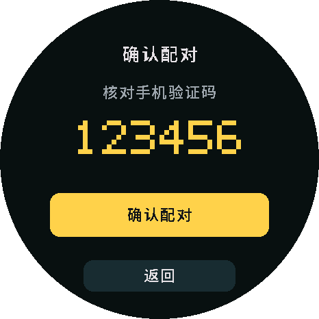
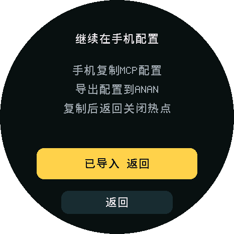
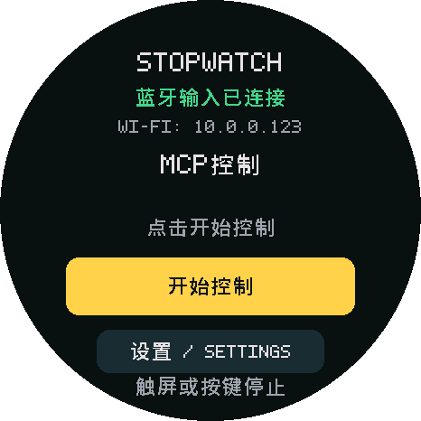
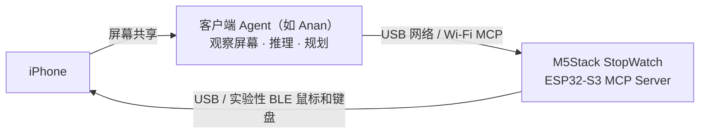

# Anan iPhone Use

[English](README.md) · 简体中文

**为 M5Stack StopWatch（ESP32-S3）开发的 iPhone MCP Server，通过 USB 或蓝牙鼠标和键盘控制 iPhone。**

客户端负责观察屏幕、决定下一步和验证结果；StopWatch 执行点击、拖动、滚动和键盘输入。固件不运行模型，也不提供手机截图。

已适配 **[Anan](https://anan.sh)（一个纯客户端 Agent，即将开源）**，也欢迎其他 MCP Agent 和 ESP32 设备；[anan-iphone-use skill](.agents/skills/anan-iphone-use/SKILL.md) 提供配置和具体板型的适配指导。

## 演示与配置

<table width="100%">
<tr>
<th width="33%">备忘录画画</th>
<th width="33%">查看小红书粉丝</th>
<th width="33%">勿扰模式与计时器</th>
</tr>
<tr>
<td width="33%" valign="top"><strong>Prompt：</strong> 打开备忘录画一个小狗</td>
<td width="33%" valign="top"><strong>Prompt：</strong> 打开小红书看下我有多少粉丝</td>
<td width="33%" valign="top"><strong>Prompt：</strong> 开启勿扰模式，再启动一个 25 分钟计时器</td>
</tr>
<tr>
<td width="33%" align="center"><video src="https://github.com/user-attachments/assets/33d7dd87-b4b1-479e-a7a7-0841db6cd780" width="260" controls></video></td>
<td width="33%" align="center"><video src="https://github.com/user-attachments/assets/1da03439-f745-4556-b9c4-40b6d5ac10b6" width="260" controls></video></td>
<td width="33%" align="center"><video src="https://github.com/user-attachments/assets/f7dc814c-bf89-4d8d-bdd8-1e7c6a837279" width="260" controls></video></td>
</tr>
</table>

烧录后，可选择连接方式：

- **无线：** 扫码加入 StopWatch 热点，打开 `http://192.168.4.1`，确认 MCP 配对后选择自己的 2.4 GHz Wi-Fi。退出配网前复制 MCP 配置；手机回到原 Wi-Fi 后导入，再在设备选择 BLE 输入，并在 iPhone 配对 **Anan StopWatch**。
- **有线：** 连接 StopWatch 与 iPhone，配置 USB 以太网（IP `192.168.7.2`、掩码 `255.255.255.0`，无路由器/DNS），打开 `http://192.168.7.1` 配对并导入 MCP。

两种方式均需开启辅助触控，再在 StopWatch 点“开始控制”。下图展示无线配置，[完整配置与恢复](docs/wireless.zh-CN.md)涵盖两种方式。

<table>
<tr>
<th>1 · 扫码加入配置热点</th>
<th>2 · 核对 MCP 配对</th>
<th>3 · 退出前复制配置</th>
<th>4 · 配对 BLE，开始控制</th>
</tr>
<tr>
<td></td>
<td></td>
<td></td>
<td></td>
</tr>
</table>

*由[固件布局](tools/render_ui.py)静态渲染的示意图，非真机截图。验证码、Wi-Fi 密码和 IP 均为合成示例；MCP 配对与蓝牙配对是两回事。*

## 工作原理

手机或电脑上的 Agent 通过 USB 网络或 Wi-Fi 访问 StopWatch 的 MCP；StopWatch 通过 USB 或实验性 BLE 向 iPhone 发送输入。网络连接与输入方式独立，因此也可以通过 Wi-Fi MCP 控制有线连接的手机。



每次动作后，客户端应重新观察屏幕，确认实际效果。工具执行完成只代表输入已发送，不代表目标操作成功。

## 你需要什么

| 项目 | 要求 |
| --- | --- |
| 设备 | M5Stack StopWatch（ESP32-S3）；首次烧录需电脑与数据线 |
| 手机 | iPhone，开启辅助触控（AssistiveTouch）；USB 输入需要 USB-C 连接 |
| 客户端 | [Anan](https://anan.sh)，或手机/电脑上能访问 USB 子网、Wi-Fi 局域网的 HTTP MCP 客户端 |
| 屏幕观察 | 由客户端提供；[Anan](https://anan.sh) 的系统屏幕共享需要 iOS 27+ |

## 快速开始

```sh
git clone https://github.com/ananhq/anan-iphone-use.git
cd anan-iphone-use
```

在仓库目录打开你使用的 Agent，输入：

```text
使用 $anan-iphone-use，帮我确认开发板、完成烧录和 iPhone MCP 配置。
若未自动识别 skill，请先读取 .agents/skills/anan-iphone-use/SKILL.md。
```

Skill 引导烧录和连接配置，也可为其他 ESP32 板型做最小适配。升级时使用 `flash.sh` / `flash.py`，保留 BLE 配对及 Wi-Fi/MCP 配置，见[烧录说明](docs/setup.zh-CN.md)。

## MCP 接口

默认地址：**`http://stopwatch.local/mcp`**，USB/Wi-Fi 共用；USB 备用地址为 `http://192.168.7.1/mcp`。导入设备导出的配置及其 Bearer 请求头，切换 USB/BLE 输入无需重新导入。

| 方法 | 用途 | 参数 |
| --- | --- | --- |
| `device_status` | 查看连接、控制授权和输入忙碌状态 | 无 |
| `tap` | 单击、双击或长按 | <ul><li><code>x, y</code>：操作位置</li><li><code>count</code>：单击（1）或双击（2）</li><li><code>holdMs</code>：长按时长</li><li><code>intervalMs</code>：双击间隔</li></ul> |
| `drag` | 滑动、拖动或连续绘图 | <ul><li><code>points</code>：有序坐标，两点为直线，多点为路径</li><li><code>durationMs</code>：移动时长</li><li><code>holdMs</code>：移动前先保持的时长</li></ul> |
| `press_key` | 键盘、编辑快捷键及系统/媒体按键 | <ul><li><code>key</code>：按键名称，如 <code>tab</code>、<code>copy</code>、<code>home</code>、<code>search</code></li><li><code>repeat</code>：导航重复次数</li><li><code>pressMs, gapMs</code>：按住时长、重复间隔</li></ul> |
| `type_ascii` | 向当前焦点输入 ASCII 文本 | <ul><li><code>text</code>：输入内容，不支持中文/Unicode</li></ul> |
| `scroll` | 滚动指定区域 | <ul><li><code>x, y</code>：目标位置</li><li><code>vertical, horizontal</code>：带符号的滚轮量，非像素</li><li><code>repeat, gapMs</code>：重复次数、间隔</li></ul> |
| `stop` | 中断输入并撤销控制授权 | 无 |

坐标为竖屏归一化 **0…1**，时间单位为毫秒；屏幕观察由客户端提供。完整参数和按键名称见[工具参考](docs/hid-tools.zh-CN.md)，连接说明见[客户端接入](docs/client.zh-CN.md)。更新固件后刷新工具目录。

## 当前限制

- Wi-Fi 使用 2.4 GHz，客户端须能访问同一局域网；配置热点会暂停 BLE，不充当互联网路由器。最多记住五个 Wi-Fi 网络。
- 只支持竖屏、单指针和 US 键盘布局的 ASCII 输入，不直接输入中文。
- BLE 输入仍为实验性；指针精度、重连、客户端兼容性和持续运行需实机验收，编译/离线结果单独记录于[验证记录](docs/validation.zh-CN.md)。

## 项目对比与致谢

感谢 **actell** 的 USB NCM/HID 源码参考，以及 **esp32-iphone-agent** 对 iPhone 硬件自动化的探索。

| 项目 | 观察与 Agent | 动作接入 | iPhone 输入 |
| --- | --- | --- | --- |
| Anan iPhone Use + [Anan](https://anan.sh) | 手机内屏幕共享与 Agent | USB/Wi-Fi MCP | USB / 实验性 BLE 绝对定位与键盘 |
| [actell](https://github.com/ja1chen/actell/tree/e701786d1686823f9ab60524e689e387b7c3b904) | 手机内 Agent、CoreDevice 显示流 | CoreDevice | CoreDevice 点击与拖动 |
| [esp32-iphone-agent](https://github.com/onehumanbeing/esp32-iphone-agent/tree/68584cfc8b3f227d6324ec7c8008c48b53f20a18) | 电脑端 AirPlay 与 Python Agent | Wi-Fi TCP | USB 相对鼠标与键盘 |

actell 另保留本项目参考的 USB NCM/HID 方案，表中列的是其 CoreDevice 方案。esp32-iphone-agent 的 MIT 许可与 Copyright (c) 2026 Henry Yuan 保留于[完整声明](licenses/esp32-iphone-agent-MIT.txt)。准确版本、文件来源和修改记录见 [THIRD_PARTY](THIRD_PARTY.zh-CN.md)。

## 许可证

项目整体采用 **[GPL-3.0-only](LICENSE)**。发行二进制时须按协议提供对应源码及所需构建材料。

保留上游版权及第三方代码、字体的适用许可，见 [NOTICE](NOTICE) 和 [THIRD_PARTY](THIRD_PARTY.zh-CN.md)。
