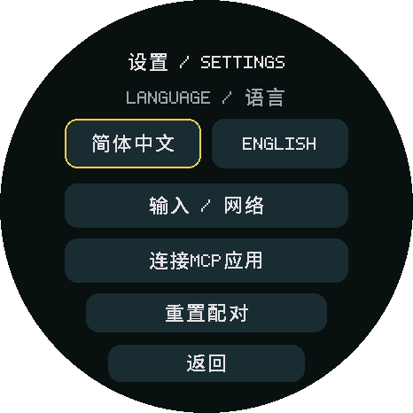
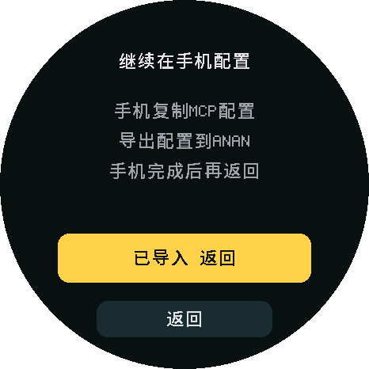
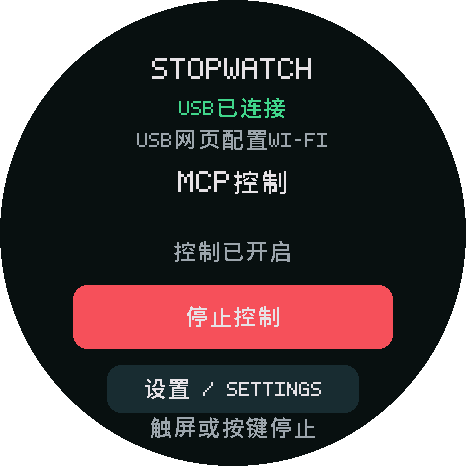
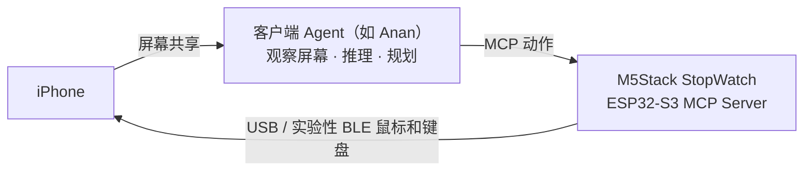

# Anan iPhone Use

[English](README.md) · 简体中文

**运行在 ESP32-S3 上的 MCP Server，通过 USB 鼠标和键盘操作真实 iPhone。**

把它接到客户端 Agent，就能为 Agent 增加 **iPhone Use** 能力：客户端看屏幕、决定下一步，通过 MCP 执行操作，再观察结果。固件负责点击、拖动、按键和 ASCII 输入，不运行模型，也不提供手机截图。

**本仓库专为 M5Stack StopWatch 开发，已适配 [Anan](https://anan.sh)（一个纯客户端 Agent，即将开源）。** 同时提供 [anan-iphone-use skill](.agents/skills/anan-iphone-use/SKILL.md)：直接让 Agent 使用 `$anan-iphone-use`，说明你使用的 Agent 和 ESP32 开发板，即可获得客户端接入与板型适配指导。

## 演示与配置

<table width="100%">
<tr>
<th width="33%">备忘录画画</th>
<th width="33%">查看小红书粉丝</th>
<th width="33%">勿扰模式与计时器</th>
</tr>
<tr>
<td width="33%" valign="top"><strong>Prompt：</strong> 打开备忘录画一个小狗</td>
<td width="33%" valign="top"><strong>Prompt：</strong> 打开小红书看下我有多少粉丝</td>
<td width="33%" valign="top"><strong>Prompt：</strong> 开启勿扰模式，再启动一个 25 分钟计时器</td>
</tr>
<tr>
<td width="33%" align="center"><video src="https://github.com/user-attachments/assets/33d7dd87-b4b1-479e-a7a7-0841db6cd780" width="260" controls></video></td>
<td width="33%" align="center"><video src="https://github.com/user-attachments/assets/1da03439-f745-4556-b9c4-40b6d5ac10b6" width="260" controls></video></td>
<td width="33%" align="center"><video src="https://github.com/user-attachments/assets/f7dc814c-bf89-4d8d-bdd8-1e7c6a837279" width="260" controls></video></td>
</tr>
</table>

**1 · 连接与局域网设置：** 连接 iPhone 与 StopWatch，在手机配置 USB 以太网：手动 IP `192.168.7.2`、掩码 `255.255.255.0`，路由器留空、不配 DNS，并开启辅助触控。之后按下图配对、导入 MCP 配置、开启控制。

<table>
<tr>
<th>2 · 进入连接设置</th>
<th>3 · 核对并确认配对</th>
<th>4 · 手机复制 JSON 并导入</th>
<th>5 · 返回，开启控制</th>
</tr>
<tr>
<td></td>
<td></td>
<td></td>
<td></td>
</tr>
</table>

*配置界面示意：由[当前固件布局](tools/render_ui.py)静态渲染，非真机截图；`123456` 是示例验证码。手机 Safari 打开 `http://192.168.7.1` 完成配对与配置导出，无需证书。完整流程由下方 skill 引导。*

## 工作原理

候选 **0.7.3-discovery** 保留 USB，增加 Wi-Fi MCP、BLE 输入、扫码连接临时配网热点和五个网络记忆。USB/Wi-Fi 的 HTTP 配置统一使用 **`http://stopwatch.local/mcp`**。编译/离线检查通过，新配网流程仍待实机验收。见[无线配置与限制](docs/wireless.zh-CN.md)。

工具描述包含打开应用、输入、浏览和绘图等简短中英文任务词。多步控制时，服务建议先了解七个工具的完整概览，再按需读取参数，见[工具发现说明](docs/tool-discovery.zh-CN.md)。



每次动作后，客户端应重新观察屏幕，确认实际效果。工具执行完成只代表输入已发送，不代表目标操作成功。

## 你需要什么

| 项目 | 要求 |
| --- | --- |
| 设备 | M5Stack StopWatch（ESP32-S3）与 USB-C 数据线 |
| 手机 | USB-C iPhone，开启辅助触控（AssistiveTouch） |
| 客户端 | [Anan](https://anan.sh)，或能访问 USB 子网/已配置 Wi-Fi 局域网的 HTTP MCP 客户端 |
| 屏幕观察 | 由客户端提供；[Anan](https://anan.sh) 的系统屏幕共享需要 iOS 27+ |

## 快速开始

```sh
git clone https://github.com/ananhq/anan-iphone-use.git
cd anan-iphone-use
```

在仓库目录打开你使用的 Agent，输入：

```text
使用 $anan-iphone-use，帮我确认开发板、完成烧录和 iPhone MCP 配置。
若未自动识别 skill，请先读取 .agents/skills/anan-iphone-use/SKILL.md。
```

[anan-iphone-use skill](.agents/skills/anan-iphone-use/SKILL.md) 会引导 StopWatch 复用固件，其他 ESP32 按实际硬件做最小适配，并处理无屏设备的操作方式。

StopWatch 升级固件时使用 `flash.sh` 或 `flash.py`，保留 BLE 配对及 Wi-Fi/MCP 配置，见[烧录说明](docs/setup.zh-CN.md)。

## MCP 接口

默认地址：`http://192.168.7.1/mcp`。配对后导出的配置包含 Bearer 请求头。

| 方法 | 用途 | 参数 |
| --- | --- | --- |
| `device_status` | 查看连接、控制授权和输入忙碌状态 | 无 |
| `tap` | 单击、双击或长按 | <ul><li><code>x, y</code>：操作位置</li><li><code>count</code>：单击（1）或双击（2）</li><li><code>holdMs</code>：长按时长</li><li><code>intervalMs</code>：双击间隔</li></ul> |
| `drag` | 滑动、拖动或连续绘图 | <ul><li><code>points</code>：有序坐标，两点为直线，多点为路径</li><li><code>durationMs</code>：移动时长</li><li><code>holdMs</code>：移动前先保持的时长</li></ul> |
| `press_key` | 键盘、编辑快捷键及系统/媒体按键 | <ul><li><code>key</code>：按键名称，如 <code>tab</code>、<code>copy</code>、<code>home</code>、<code>search</code></li><li><code>repeat</code>：导航重复次数</li><li><code>pressMs, gapMs</code>：按住时长、重复间隔</li></ul> |
| `type_ascii` | 向当前焦点输入 ASCII 文本 | <ul><li><code>text</code>：输入内容，不支持中文/Unicode</li></ul> |
| `scroll` | 滚动指定区域 | <ul><li><code>x, y</code>：目标位置</li><li><code>vertical, horizontal</code>：带符号的滚轮量，非像素</li><li><code>repeat, gapMs</code>：重复次数、间隔</li></ul> |
| `stop` | 中断输入并撤销控制授权 | 无 |

坐标为竖屏归一化 **0…1**，时间单位为毫秒；屏幕观察由客户端提供。完整参数和按键名称见[工具参考](docs/hid-tools.zh-CN.md)，连接说明见[客户端接入](docs/client.zh-CN.md)。更新固件后刷新工具目录。

## 当前限制

- 当前适配 M5Stack StopWatch。Wi-Fi MCP 与 BLE 输入已作为候选实现，真机未验证；首次 Wi-Fi 配网可使用 USB 或设备临时热点。
- 只支持竖屏、单指针和 US 键盘布局的 ASCII 输入，不直接输入中文。
- 其他客户端兼容性、最新仅 MCP 固件的真机回归与持续运行仍需验证，见[验证记录](docs/validation.zh-CN.md)。

## 项目对比与致谢

感谢 **actell** 的 USB NCM/HID 源码参考，以及 **esp32-iphone-agent** 对 iPhone 硬件自动化的探索。

| 项目 | 观察与 Agent | 动作接入 | iPhone 输入 |
| --- | --- | --- | --- |
| Anan iPhone Use + [Anan](https://anan.sh) | 手机内屏幕共享与 Agent | MCP | USB 绝对坐标鼠标与键盘 |
| [actell](https://github.com/ja1chen/actell/tree/e701786d1686823f9ab60524e689e387b7c3b904) | 手机内 Agent、CoreDevice 显示流 | CoreDevice | CoreDevice 点击与拖动 |
| [esp32-iphone-agent](https://github.com/onehumanbeing/esp32-iphone-agent/tree/68584cfc8b3f227d6324ec7c8008c48b53f20a18) | 电脑端 AirPlay 与 Python Agent | Wi-Fi TCP | USB 相对鼠标与键盘 |

actell 另保留本项目参考的 USB NCM/HID 方案，表中列的是其 CoreDevice 方案。esp32-iphone-agent 的 MIT 许可与 Copyright (c) 2026 Henry Yuan 保留于[完整声明](licenses/esp32-iphone-agent-MIT.txt)。准确版本、文件来源和修改记录见 [THIRD_PARTY](THIRD_PARTY.zh-CN.md)。

## 许可证

项目整体采用 **[GPL-3.0-only](LICENSE)**。发行二进制时须按协议提供对应源码及所需构建材料。

保留上游版权及第三方代码、字体的适用许可，见 [NOTICE](NOTICE) 和 [THIRD_PARTY](THIRD_PARTY.zh-CN.md)。
